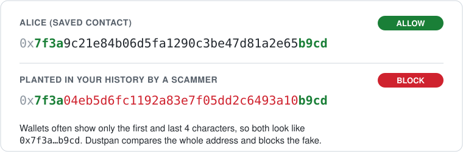
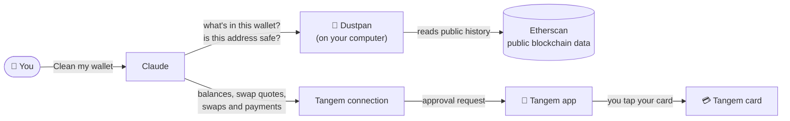
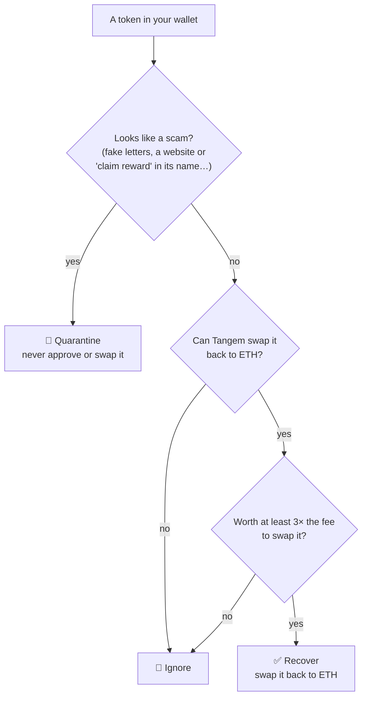
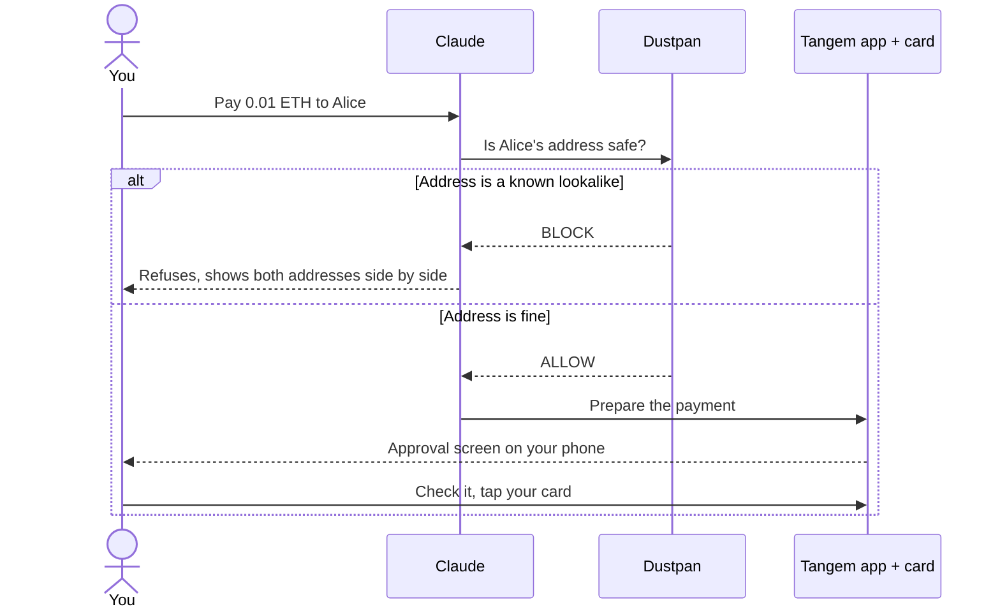

# Dustpan

> Tangem makes sure a human approves. Dustpan makes sure the human knows what they're approving.

Dustpan is a helper for your Tangem wallet that works inside Claude. Ask it to **"clean my wallet"** and it sorts every token you hold into three groups:

1. **Recover:** small leftover balances ("dust") that are worth swapping back to ETH, after fees.
2. **Ignore:** balances so small that the fee to move them costs more than they're worth.
3. **Quarantine:** scam tokens, plus **fake lookalike addresses** that scammers planted in your history. These look like someone you pay (same first 4 and last 4 characters) but belong to a scammer. Dustpan remembers them and refuses to let Claude send money to them.

<p align="center">
  
</p>

Dustpan only reads public blockchain data. It never holds your keys and never signs anything: every swap and payment still needs you to approve it by tapping your Tangem card.

## How it works



Dustpan only advises. Nothing moves until you approve it on your phone and tap your card.

### How each token gets sorted



### What happens when you pay someone



---

## Setup guide (about 10 minutes)

### What you need

- A **Tangem card or ring** and the **Tangem app** (version 6.8.1 or later) on your phone.
- A computer (Mac, Windows or Linux) with **[Claude Code](https://claude.com/claude-code)** installed.
- **uv**, a small tool that runs Dustpan for you. Install it from [docs.astral.sh/uv](https://docs.astral.sh/uv/getting-started/installation/) (on a Mac with Homebrew: `brew install uv`).
- A free **Etherscan API key**. Dustpan uses it to read your wallet history.

### Step 1: Get a free Etherscan key

1. Go to [etherscan.io/apis](https://etherscan.io/apis) and create a free account.
2. In your account, open **API Keys** and click **Add**.
3. Copy the key. It looks like a long string of letters and numbers.

### Step 2: Add Dustpan and Tangem to Claude

Open a terminal and paste these two commands. Replace `YOUR_KEY` with the key from step 1.

```bash
claude mcp add --scope user dustpan -e ETHERSCAN_API_KEY=YOUR_KEY -- uvx --from git+https://github.com/sunilramjali/dustpan dustpan
claude mcp add --transport http --scope user tangem https://mcp.tangem.org/mcp
```

The first command adds Dustpan, and the second adds Tangem's official connection. `--scope user` means both work from any folder.

### Step 3: Prepare the Tangem app

On your phone, in the Tangem app:

1. Add the networks you use, for example **Arbitrum One** or **Ethereum**.
2. Turn off **dynamic addresses**, so your wallet keeps one fixed address.

### Step 4: Connect your wallet to Claude

1. In the terminal, type `claude` and press Enter.
2. Type `/mcp` and press Enter.
3. Choose **tangem**, then **Authenticate**.
4. Approve the request in the Tangem app on your phone.

Back in `/mcp`, both **tangem** and **dustpan** should now show as connected.

### Step 5: Save the people you pay

Dustpan spots fakes by comparing addresses to people you trust. Tell Claude about them in plain words:

> Save Alice as a contact: 0x1234…abcd

(Anyone you've already sent money to counts as trusted automatically.)

### Step 6: Use it

Just ask Claude in normal language:

| Say this | What happens |
|---|---|
| **Clean my wallet** | You get the three groups (Recover / Ignore / Quarantine) and a 0–100 wallet health score. |
| **Clean my wallet on Ethereum** | Same, for a different network. Arbitrum One is the default. |
| **Recover the GMX** (any token from the Recover list) | Claude sets up the swap. Your phone asks you to approve, and you tap your card. |
| **Pay 0.01 ETH to Alice** | Dustpan checks the address first. If it's a known fake, Claude refuses and shows you both addresses side by side. |

---

## Good to know

- **Networks:** Ethereum and Arbitrum One work with the free Etherscan key. Base needs a paid Etherscan plan.
- **Your data stays on your computer.** Contacts and the list of blocked addresses are saved in a `.dustpan` folder in your home folder.
- **Always read the approval screen** on your phone before tapping your card. Dustpan makes scams much easier to spot, but your tap is the final check.
- **Built and tested with Claude Code.**

## Troubleshooting

| Problem | Fix |
|---|---|
| `/mcp` shows **tangem: Needs authentication** | Repeat step 4 and approve on your phone. |
| **dustpan** shows as failed | Check that uv is installed (`uv --version`), then restart Claude. |
| "Etherscan could not read … history" | Check your key in step 2. On Base, you need a paid Etherscan plan. |
| "Max calls per sec rate limit reached" | Dustpan retries automatically. If it still fails, wait a few seconds and ask again. |
| A token you hold doesn't appear | Dustpan looks at recent history (the last 200 transfers). |

## Updating or removing

- **Update to the latest version:** `uv cache clean dustpan`, then restart Claude.
- **Remove:** `claude mcp remove dustpan -s user` (and `claude mcp remove tangem -s user` if you also want to disconnect Tangem).

---

## For developers

To change the code, clone the repo and point Claude at your copy instead:

```bash
git clone https://github.com/sunilramjali/dustpan && cd dustpan
uv sync
claude mcp add --scope user dustpan -e ETHERSCAN_API_KEY=YOUR_KEY -- uv run --directory "$PWD" dustpan
```

| Tool | What it does |
|---|---|
| `scan_wallet(address, network)` | Finds ERC-20s and poisoned lookalikes in recent history (via Etherscan V2; Blockscout fallback without a key) |
| `classify(tokens, gas_cost_native_wei)` | Sorts into recover / ignore / quarantine, with a 0-100 hygiene score |
| `gas_price(network)` | Current gas price, to cost a swap from the Tangem quote |
| `check_recipient(to_address)` | Send guard: ALLOW or BLOCK, called before every Tangem send |
| `add_contact(name, address)` | Saves a trusted contact |

Data folder: `~/.dustpan` (override with the `DUSTPAN_DATA_DIR` environment variable).

Idea credit: the dust-recovery idea came from a fellow hacker at the Encode x Tangem MCP hackathon.

## License

MIT. See [LICENSE](LICENSE). Dustpan is a hackathon project: review it before trusting it with real funds.
